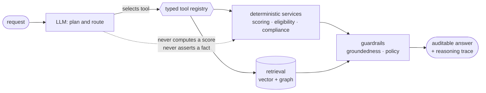

# Palak Namdev

**AI/ML Engineer — Agentic AI · Generative AI · LLM Infrastructure**

I build production LLM systems: multi-agent orchestration, enterprise RAG, and the
infrastructure that keeps both auditable and cheap to run.

---

## How I build agents

The LLM plans, routes and explains. It never computes a score or asserts a fact — that
stays with deterministic code. It's the only way an AI decision survives a regulated review.

---

## Selected work

<b>RM-Copilot</b> — agentic copilot for retail banking

> A natural-language request becomes a ranked customer list, product recommendations,
> compliance-checked outreach drafts and a per-decision reasoning trace. The cognition /
> execution split above is this project's core idea.

`FastAPI + SSE` · `typed tool registry` · `versioned prompts` · `guardrails` · `120 tests`

→ [github.com/palak178/RM-Copilot](https://github.com/palak178/RM-Copilot)

<b>audio-transcription-pipeline</b> — offline speech-to-text

> Memory stays bounded independent of audio length, by windowing at silence rather than at
> fixed intervals. Content-probes with ffprobe instead of trusting file extensions, and
> enables VAD by default because Whisper hallucinates on silence.

`faster-whisper` · `CTranslate2` · `Typer CLI` · `queue-backed async` · `CPU-only`

→ [github.com/palak178/audio-transcription-pipeline](https://github.com/palak178/audio-transcription-pipeline)

<b>LLM_Chatbot</b> — RAG over uploaded documents

> Answers grounded strictly in retrieved passages, with embeddings persisted to a vector
> store so the same corpus isn't re-embedded on every session.

`SentenceTransformer` · `Qdrant` · `Streamlit`

→ [github.com/palak178/LLM_Chatbot](https://github.com/palak178/LLM_Chatbot)

---

## Tech

<b>Agentic AI &amp; Orchestration</b>

LangGraph · AutoGen GraphFlow · Multi-Agent Systems · Stateful Graph Execution ·
DAG Scheduling · Conditional Routing · Tool Calling · MCP · Human-in-the-Loop ·
State Management · Fault Tolerance &amp; Retries

<b>Generative AI &amp; LLM Engineering</b>

LangChain · LlamaIndex · LiteLLM · Prompt &amp; Context Engineering · Guardrails ·
LLM &amp; Agent Evaluation · Model Benchmarking · Prompt Caching ·
Token &amp; Cost Optimization · Groundedness &amp; Citation

<b>RAG &amp; Retrieval</b>

VectorRAG · GraphRAG · Agentic RAG · Multi-Tenant Retrieval · Hybrid Search
(semantic + keyword) · Reranking · Chunking Strategies · Metadata Filtering ·
Embeddings · Knowledge Graphs

<b>Document &amp; Multimodal AI</b>

Intelligent Document Processing (IDP) · Structured / Unstructured Parsing · OCR ·
Borderless Table Parsing · Markdown &amp; HTML Conversion · Image / Audio / Video
Ingestion · Speech-to-Text · Speaker Diarization · Web Scraping

<b>ML &amp; NLP</b>

Machine Learning · Deep Learning · NLP · Transformers · Hugging Face · PyTorch ·
TensorFlow · Scikit-learn · Computer Vision · OpenCV · Pandas · NumPy

<b>Backend &amp; Distributed Systems</b>

Python · FastAPI · Django · Flask · Pydantic · REST APIs · Celery · RabbitMQ · Redis ·
Microservices · Async Processing · Horizontal Scaling · SQL

<b>Models, Data &amp; Cloud</b>

**Models** — GPT · Claude · Gemini · LLaMA · Mistral · Qwen · DeepSeek · Whisper

**Data &amp; vector stores** — PostgreSQL / pgvector · MongoDB · SQLite · Pinecone ·
Qdrant · Weaviate · ChromaDB · Neo4j

**Cloud &amp; DevOps** — Azure · AWS · Docker · CI/CD · Git · Linux · GPU Inference ·
Grafana · LangSmith

---

## Certifications

<b>4 certifications</b> — Anthropic, Microsoft, Weaviate

- **Claude Certified Architect — Foundation**, Anthropic
- **Claude Code in Action**, Anthropic
- AI Agentic Design Patterns with AutoGen — Microsoft / DeepLearning.AI
- Building Multimodal Search and RAG — Weaviate / DeepLearning.AI

---

Interested in stateful agent graphs, retrieval quality you can actually measure,
multi-tenant isolation, and keeping token cost bounded under concurrency.

📫 **palak.namdev1701@gmail.com** · [LinkedIn](https://www.linkedin.com/in/palak-namdev)
