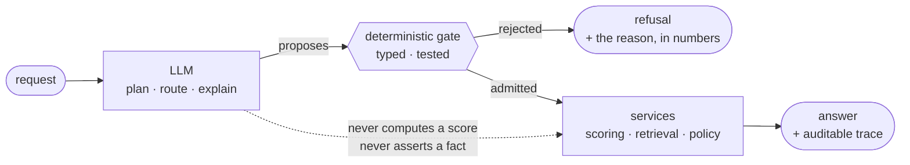

# Palak Namdev

**AI/ML Engineer — Agentic AI · Generative AI · LLM Infrastructure**

I build production LLM systems: multi-agent orchestration, enterprise RAG, and the
infrastructure that keeps both auditable and cheap to run. Three years of it, mostly on a
platform delivering to enterprise customers in banking, legal and healthcare — requirements
through to deployment and production support.

---

## One idea, in every repository below

> **The LLM plans; deterministic code decides.**

A model is very good at choosing what to do and explaining it, and structurally unable to
guarantee that what it just said is true. So I give it the first job and never the second.
Scores, eligibility, citations, policy verdicts, spend limits — those live in ordinary code
with tests, where a reviewer can check them.

It is not an abstract preference — it is the same seam in five different problems:

| Project | The model proposes | Plain code decides |
|---|---|---|
| **RM-Copilot** | which tool to call, how to word outreach | the score, the eligibility, the compliance verdict |
| **ragkit** | an answer *and the quote supporting it* | whether that quote is really in the source |
| **Product Insight Agent** | how to explain a finding | every number inside it |
| **audio-transcription-pipeline** | — | when to window, retry, resume, give up |
| **llmgate** | — | whether a request can be sent at all |

The last two have no model in the decision path by design. That is the point: most of what
makes an LLM system trustworthy is not the LLM.

---

## Selected work

<b>ragkit</b> — grounded RAG: a cited answer, or an explicit refusal

> Never an uncited one. The model returns an answer **and the evidence it used**; deterministic
> code then looks for each quote in the passage it was attributed to. A quote that isn't there
> is not evidence, however plausible it reads — and one unverifiable citation withholds the
> whole answer, not just that sentence. Precision over recall, deliberately: an answer nobody
> can audit is worth less than an honest "not found".
>
> Ships an eval harness, because "95% accuracy" isn't a checkable claim without a metric, a *k*
> and a query count. It scores correct **refusals** as their own category, since a system that
> answers everything would otherwise look perfect.

`two deterministic gates` · `Qdrant` · `FastAPI` · `191 tests, fully offline`

→ [github.com/palak178/ragkit](https://github.com/palak178/ragkit)

<b>RM-Copilot</b> — agentic copilot for retail banking

> A natural-language request becomes a ranked customer list, product recommendations,
> compliance-checked outreach drafts and a per-decision reasoning trace. The LLM selects tools
> and writes prose; it never computes a score or asserts a fact, which is what makes a
> recommendation reproducible and reviewable after the fact.

`FastAPI + SSE` · `typed tool registry` · `versioned prompts` · `guardrails` · `120 tests`

→ [github.com/palak178/RM-Copilot](https://github.com/palak178/RM-Copilot)

<b>audio-transcription-pipeline</b> — offline speech-to-text at arbitrary length

> Memory stays bounded regardless of audio duration, because windowing happens at silence
> rather than at fixed intervals. Job state and the queue live in **one** Postgres table via
> `SELECT … FOR UPDATE SKIP LOCKED` — two systems would make claiming a job and recording that
> claim a dual write that can disagree. Jittered backoff, dead-lettering, and per-window
> checkpoints so an interrupted job resumes instead of restarting.
>
> Content-probes with ffprobe rather than trusting a file extension, and enables VAD by default
> because Whisper hallucinates on silence. Speaker diarisation runs on an ungated ONNX embedding
> model, with overlapping windows clustered globally so a label means the same person across the
> whole file, and a DER harness that scores against RTTM ground truth.

`faster-whisper` · `CTranslate2` · `Postgres queue` · `diarisation` · `CPU-only` · `212 tests`

→ [github.com/palak178/audio-transcription-pipeline](https://github.com/palak178/audio-transcription-pipeline)

<b>llmgate</b> — an LLM client that refuses requests it can prove will fail

> Two failure modes are knowable *before* the call: a prompt that exceeds the context window,
> and a call that would breach the budget. Both are checked before anything leaves the process.
> Budgets are enforced on the **worst case**, not an expected value, because a ceiling that
> holds on average is not a ceiling.
>
> Context trimming protects the system prompt and the question being answered, and drops turn
> pairs together — the three things an oldest-first loop gets wrong. Retries distinguish
> transient from permanent, and default an unrecognised error to *not* retryable.

`zero runtime dependencies` · `OpenAI + Anthropic` · `cost ceilings` · `model router` · `88 tests`

→ [github.com/palak178/llmgate](https://github.com/palak178/llmgate)

<b>Product Insight Agent</b> — analysis where the LLM cannot change a number

> Metrics are arithmetic, computed in Python and covered by tests. Narrative is prose, and
> prose is the only thing the model is allowed to supply. Its output is schema-validated,
> filtered to ids that exist, and applied to frozen models — so a bug in the enrichment path
> still cannot overwrite a metric. The test suite is a series of attempts to make it do so.

`frozen models` · `structured outputs` · `FastAPI + Typer` · `no pandas` · `78 tests`

→ [github.com/palak178/Product-Insight-Agent](https://github.com/palak178/Product-Insight-Agent)

---

## What I work with

<b>Agentic AI &amp; LLM engineering</b> — the day job

AutoGen GraphFlow · LangGraph · Multi-Agent Systems · Stateful Graph Execution ·
DAG Scheduling · Conditional Routing · Tool Calling · MCP · Human-in-the-Loop ·
Fault Tolerance &amp; Retries · LangChain · LlamaIndex · LiteLLM ·
Prompt &amp; Context Engineering · Structured Outputs · Guardrails ·
LLM &amp; Agent Evaluation · Groundedness &amp; Citation · Token &amp; Cost Optimization ·
Prompt Caching · Model Benchmarking

<b>RAG, retrieval &amp; document AI</b>

VectorRAG · GraphRAG · Agentic RAG · Multi-Tenant Retrieval · Hybrid Search
(semantic + keyword) · Reranking · Chunking Strategies · Metadata Filtering · Embeddings ·
Knowledge Graphs · Intelligent Document Processing · OCR · Borderless Table Parsing ·
Speech-to-Text · Speaker Diarisation · Web Scraping

<b>Backend, data &amp; infrastructure</b>

**Backend** — Python · FastAPI · Django · Flask · Pydantic · REST APIs · Celery ·
RabbitMQ · Redis · Async Processing · Horizontal Scaling · SQL

**Models** — GPT · Claude · Gemini · LLaMA · Mistral · Qwen · DeepSeek · Whisper

**Data &amp; vector stores** — PostgreSQL / pgvector · MongoDB · SQLite · Qdrant ·
Pinecone · Weaviate · ChromaDB · Neo4j

**Cloud &amp; DevOps** — Azure · AWS · Docker · CI/CD · Git · Linux · GPU Inference · Grafana

<b>ML foundations</b> — context, not what I ship

Machine Learning · NLP · Transformers · Hugging Face · PyTorch · TensorFlow ·
Scikit-learn · Computer Vision · OpenCV · Pandas · NumPy

Used in training and academic work, and OpenCV for image pre-processing inside document
pipelines. My production work for the last three years has been GenAI, agentic systems and
retrieval — listed here as background rather than as a claim to have trained and deployed
models.

---

## Certifications

- **Claude Certified Architect — Foundation** · Anthropic
- **Claude Code in Action** · Anthropic
- AI Agentic Design Patterns with AutoGen · Microsoft / DeepLearning.AI
- Building Multimodal Search and RAG · Weaviate / DeepLearning.AI

---

Currently interested in stateful agent graphs, retrieval quality you can actually measure,
multi-tenant isolation, and keeping token cost bounded under concurrency.

Based in Indore, India. Three years of remote-first delivery, including US customers.

📫 **palak.namdev1701@gmail.com** · [LinkedIn](https://www.linkedin.com/in/palak-namdev)
